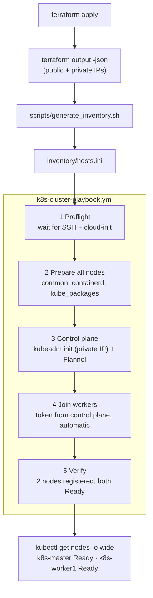

# Ansible — Kubernetes Cluster Installation

Documentation for the `ansible/` part of the BARQ project: how a pair of fresh Ubuntu EC2 instances (created by Terraform) become a working **kubeadm** Kubernetes cluster, and how the playbook can be re-run safely.

---

## 1. Assignment requirements → how they are met

| Requirement (assignment §2) | Where / how |
|---|---|
| Use the EC2 addresses produced by Terraform to populate the inventory | `scripts/generate_inventory.sh` reads `terraform output -json` and writes `inventory/hosts.ini` |
| Prepare both nodes; install containerd, kubeadm, kubelet, kubectl | `tasks/common.yml`, `tasks/containerd.yml`, `tasks/kube_packages.yml` |
| Initialize the control plane using its **private IP** | `tasks/control_plane.yml` → `kubeadm init --apiserver-advertise-address={{ private_ip }}` |
| Install a compatible CNI plugin | Flannel (pinned `flannel_version`), pod CIDR `10.244.0.0/16` |
| Join the worker automatically | `tasks/worker.yml` fetches a fresh join command from the control plane via `delegate_to` |
| Verify that both nodes show Ready | Play 5 of `k8s-cluster-playbook.yml` (`kubectl wait --for=condition=Ready`) |
| Playbooks can run again without reinitializing or breaking the cluster | Guards (`stat`, `creates`, idempotent modules) — see [§8](#8-idempotency-design) |

---

## 2. Structure

```text
ansible/
├── ansible.cfg                    # defaults: user, privilege escalation, SSH tuning
├── requirements.yml               # collections: ansible.posix, community.general
├── group_vars/all.yml             # Kubernetes minor version, pod CIDR, Flannel version
├── inventory/
│   └── hosts.ini.example          # template (real hosts.ini is generated, never committed)
├── scripts/
│   └── generate_inventory.sh      # Terraform outputs -> inventory/hosts.ini
├── k8s-cluster-playbook.yml       # main playbook (5 plays)
└── tasks/
    ├── common.yml                 # hostname, /etc/hosts, swap, kernel modules, sysctl, packages
    ├── containerd.yml             # container runtime + systemd cgroup driver
    ├── kube_packages.yml          # kubernetes apt repo, kubelet/kubeadm/kubectl (held)
    ├── control_plane.yml          # kubeadm init, kubeconfig, Flannel
    └── worker.yml                 # automatic kubeadm join
```

---

## 3. Flow



---

## 4. Prerequisites

| Item | Requirement |
|---|---|
| Control machine | Linux/macOS/WSL with **Ansible ≥ 2.15**, `jq`, `terraform`, an SSH client |
| Collections | `ansible-galaxy collection install -r requirements.yml` |
| Target OS | Ubuntu 24.04 LTS (user `ubuntu`, passwordless sudo — default on the Ubuntu EC2 AMI) |
| SSH key | The `.pem` of the EC2 key pair Terraform used (`key_name`). **Never commit it.** |
| Network | Your public IP is in `allowed_ssh_cidr` (Terraform) so TCP/22 reaches both nodes. Nodes need outbound internet (apt, `pkgs.k8s.io`, GitHub for the Flannel manifest) |
| Security groups | 6443/tcp (worker → control plane), 10250/tcp (control plane → worker), 8472/udp (Flannel, both directions) — created by Terraform |

---

## 5. Inventory generation method

The inventory is **never edited by hand**. Terraform is the single source of truth.

```bash
cd ansible
export BARQ_SSH_KEY=~/.ssh/barq-k8s-key.pem      # path to your private key
./scripts/generate_inventory.sh
```

What the script does:

1. Verifies `terraform` and `jq` exist.
2. Runs `terraform -chdir=../terraform/root output -json`.
3. Extracts four outputs: `control_plane_public_ip`, `control_plane_private_ip`, `worker_public_ip`, `worker_private_ip` (it stops with a clear error if one is missing).
4. Writes `inventory/hosts.ini`.

| Variable | Default | Purpose |
|---|---|---|
| `TF_DIR` | `../terraform/root` | Where Terraform state/outputs live |
| `BARQ_SSH_KEY` | `~/.ssh/barq-k8s-key.pem` | Private key written into the inventory |
| `SSH_USER` | `ubuntu` | Remote user |

Generated file (example values):

```ini
[control_plane]
k8s-master  ansible_host=<CONTROL_PLANE_PUBLIC_IP>  private_ip=<CONTROL_PLANE_PRIVATE_IP>

[workers]
k8s-worker1 ansible_host=<WORKER_PUBLIC_IP>  private_ip=<WORKER_PRIVATE_IP>

[k8s:children]
control_plane
workers

[k8s:vars]
ansible_user=ubuntu
ansible_ssh_private_key_file=~/.ssh/barq-k8s-key.pem
```

**Two addresses per host, on purpose:**

- `ansible_host` (public IP) → where Ansible connects over SSH.
- `private_ip` → what Kubernetes uses (`--apiserver-advertise-address`, `/etc/hosts`). The public IP is added to the API server certificate SANs so `kubectl` also works from outside.

> `inventory/hosts.ini` is in `.gitignore`. After every `stop/start` of the EC2 instances the public IPs change — just re-run the script.

---

## 6. Configuration

### `ansible.cfg`

| Setting | Value | Why |
|---|---|---|
| `inventory` | `inventory/hosts.ini` | No `-i` needed |
| `remote_user` | `ubuntu` | Default user of the Ubuntu AMI |
| `host_key_checking` | `True` | Secure default; see [troubleshooting](#11-troubleshooting) for the first connection |
| `become` | `True` | Everything needs root |
| `pipelining`, `ControlPersist` | on | Faster SSH, fewer connections |
| `retry_files_enabled` | `False` | No `.retry` clutter |

### `group_vars/all.yml`

| Variable | Value | Meaning |
|---|---|---|
| `k8s_minor` | `v1.34` | Kubernetes minor version → selects the `pkgs.k8s.io` repository |
| `pod_cidr` | `10.244.0.0/16` | Pod network; must match Flannel and **must not overlap the VPC CIDR** |
| `flannel_version` | `v0.28.9` | Pinned release (reproducible, not `latest`) |
| `flannel_manifest` | derived URL | Manifest applied after `kubeadm init` |

---

## 7. Playbook walk-through

### Play 1 — Preflight (all nodes)

| Task | Purpose |
|---|---|
| `wait_for_connection` (300 s) | A freshly created EC2 may not accept SSH yet |
| `cloud-init status --wait` | Prevents `apt` lock errors while cloud-init is still installing packages |

### Play 2 — Prepare all nodes

**`tasks/common.yml`**

| Task | Why Kubernetes needs it |
|---|---|
| Set hostname = inventory name | Unique, predictable node names (`k8s-master`, `k8s-worker1`) |
| `/etc/hosts` block with all nodes (private IPs) | Nodes resolve each other by name |
| `swapoff -a` + comment swap in `/etc/fstab` | kubelet refuses to run with swap on |
| `overlay`, `br_netfilter` modules (now + at boot) | Container filesystem and iptables visibility of bridged pod traffic |
| sysctl `bridge-nf-call-iptables`, `bridge-nf-call-ip6tables`, `ip_forward` = 1 | Pod ↔ pod and pod ↔ service routing |
| Packages: `apt-transport-https`, `ca-certificates`, `curl`, `gpg`, `conntrack` | Needed to add the repo and run kube-proxy |

**`tasks/containerd.yml`**

| Task | Detail |
|---|---|
| Install `containerd` | Container runtime used through the CRI |
| Generate default config | Only if `/etc/containerd/config.toml` does not exist (`creates:`) |
| `SystemdCgroup = true` | Must match the kubelet's cgroup driver, otherwise pods restart in a loop |
| Handler `Restart containerd` | Restarts only when the config actually changed |

**`tasks/kube_packages.yml`**

| Task | Detail |
|---|---|
| Add apt key + repo for `{{ k8s_minor }}` | Key fetched once (`creates:`) |
| Install `kubelet kubeadm kubectl` | Same version family on every node |
| `dpkg_selections: hold` | A routine `apt upgrade` can never upgrade Kubernetes by accident |
| Enable `kubelet` | Starts after init/join (it restarts in a loop before that — normal) |

### Play 3 — Initialize the control plane (`control_plane`)

| Task | Detail |
|---|---|
| `stat /etc/kubernetes/admin.conf` | **The idempotency guard**: this file exists only after a successful `kubeadm init` |
| `kubeadm init` (only if the file is missing) | `--apiserver-advertise-address={{ private_ip }}` (assignment requirement), `--apiserver-cert-extra-sans={{ ansible_host }}`, `--pod-network-cidr={{ pod_cidr }}` |
| Copy `admin.conf` → `~ubuntu/.kube/config` | `kubectl` works for the SSH user without `sudo` |
| `kubectl apply -f <flannel manifest>` | CNI. `changed` only when something was actually `created` |

### Play 4 — Join workers (`workers`)

| Task | Detail |
|---|---|
| `stat /etc/kubernetes/kubelet.conf` | Exists only after a successful join → guard |
| `kubeadm token create --print-join-command` | `delegate_to` the control plane — **no token is copied by hand** |
| Run the join command | Skipped if the node already joined. `no_log: true` keeps the token out of the output |

### Play 5 — Verify (`control_plane`)

1. Wait (up to 30 × 10 s) until **exactly two** nodes are registered.
2. `kubectl wait --for=condition=Ready nodes --all --timeout=300s`.
3. Print `kubectl get nodes -o wide`.

If any step fails, the playbook fails — a green run **is** the proof that both nodes are Ready.

---

## 8. Idempotency design

"Run it again without breaking the cluster" is solved with four techniques:

| Technique | Used for |
|---|---|
| **State-based modules** (`apt`, `sysctl`, `blockinfile`, `replace`, `copy`, `service`, `hostname`) | They compare the desired and actual state and report `ok` when equal |
| **`stat` + `when`** | `kubeadm init` and `kubeadm join` — the two commands that must never repeat |
| **`creates:`** | GPG key download, default containerd config |
| **`changed_when` / handlers** | Flannel apply, containerd restart — reported accurately, no false `changed` |

Expected behaviour:

| Run | Result |
|---|---|
| 1st (fresh nodes) | Many `changed`; cluster is built |
| 2nd and later | `changed=0` on every host; `kubeadm init/join` are skipped; nodes stay Ready |

---

## 9. How to run

```bash
cd ansible
ansible-galaxy collection install -r requirements.yml
export BARQ_SSH_KEY=~/.ssh/barq-k8s-key.pem
./scripts/generate_inventory.sh

export ANSIBLE_HOST_KEY_CHECKING=False     # first connection to new hosts (see §11)
ansible all -m ping                        # both hosts must answer "pong"

ansible-playbook k8s-cluster-playbook.yml  # 1st run: builds the cluster
ansible-playbook k8s-cluster-playbook.yml  # 2nd run: rerun proof (changed=0)
```

Useful variants:

```bash
ansible-playbook k8s-cluster-playbook.yml --check             # dry run
ansible-playbook k8s-cluster-playbook.yml --limit k8s-worker1 # one node
ansible-playbook k8s-cluster-playbook.yml -v                  # more detail
```

Check the result on the control plane:

```bash
ssh -i ~/.ssh/barq-k8s-key.pem ubuntu@<control_plane_public_ip>
kubectl get nodes -o wide
kubectl get pods -A
```

---

## 10. Evidence to capture (submission)

| # | Evidence | Command | What it must show |
|---|---|---|---|
| 1 | Terraform outputs | `terraform output` | Public/private IPs of both nodes |
| 2 | Generated inventory | `cat inventory/hosts.ini` | Two hosts, `ansible_host` + `private_ip` |
| 3 | Connectivity | `ansible all -m ping` | `SUCCESS` / `pong` for both |
| 4 | **First run** | `ansible-playbook k8s-cluster-playbook.yml` | `PLAY RECAP` with `changed>0`, `failed=0`, `unreachable=0` |
| 5 | Node readiness | `kubectl get nodes -o wide` | `k8s-master` (control-plane) and `k8s-worker1` both **Ready**, internal IPs = private IPs |
| 6 | System pods | `kubectl get pods -A` | `kube-system` and `kube-flannel` pods all `Running` |
| 7 | **Rerun** | `ansible-playbook k8s-cluster-playbook.yml` | `PLAY RECAP` with `changed=0`, `failed=0`; `kubeadm init/join` tasks `skipping` |
| 8 | Cluster preserved | `kubectl get nodes` right after the rerun | Both still **Ready**, same ages (not re-created) |

Tip: take screenshots of 4 and 7 side by side — the contrast between *many changed* and *changed=0* is the clearest proof of idempotency.

> Cross-node pod networking and Service DNS evidence (screenshots) is kept with the project submission, not in this repository.

---

## 11. Troubleshooting

| Symptom | Cause | Fix |
|---|---|---|
| `Host key verification failed` on first `ping` | `host_key_checking = True` and the EC2 host is new | `export ANSIBLE_HOST_KEY_CHECKING=False`, or `ssh-keyscan -H <ip> >> ~/.ssh/known_hosts` |
| `Permission denied (publickey)` | Wrong key or key not the one used by Terraform | Check `ansible_ssh_private_key_file`, `chmod 400` the `.pem`, confirm the key pair name |
| SSH timeout / unreachable | Your IP changed, or the instance IPs changed after stop/start | Update `allowed_ssh_cidr` + `terraform apply`; re-run `generate_inventory.sh` |
| `Terraform output '<name>' is missing` | Output not defined/applied | Add it to `terraform/root/outputs.tf`, `terraform apply`, retry |
| `Could not get lock /var/lib/dpkg/lock-frontend` | cloud-init / unattended-upgrades still running | Re-run; Play 1 normally waits for cloud-init |
| `kubeadm init` preflight error about CRI / `containerd` | `config.toml` missing the CRI plugin or `SystemdCgroup` | On the node: `containerd config default \| sudo tee /etc/containerd/config.toml`, set `SystemdCgroup = true`, `sudo systemctl restart containerd`, re-run |
| Nodes stay `NotReady` | Flannel not running or UDP 8472 blocked | `kubectl -n kube-flannel get pods`; check the Flannel security-group rules; check `pod_cidr` vs VPC CIDR |
| Worker join fails / times out | Port 6443 blocked, or a stale half-join | Check the worker → control plane 6443 rule; on the worker: `sudo kubeadm reset -f && sudo rm -rf /etc/cni/net.d`, re-run |
| `kubectl` says connection refused to `localhost:8080` | Running as a user without kubeconfig | Use `ubuntu` on the control plane (`~/.kube/config` is created) or `sudo KUBECONFIG=/etc/kubernetes/admin.conf kubectl …` |
| Rerun shows `changed` on the Flannel task | Manifest URL/version changed (new objects created) | Expected once after changing `flannel_version`; later runs return to `changed=0` |
| Interrupted run (Ctrl+C during `kubeadm init`) | — | Just re-run: the `stat` guards decide what is still missing. If `admin.conf` is half-written, reset the node (below) |

---

## 12. Reset a node (start over)

```bash
sudo kubeadm reset -f
sudo rm -rf /etc/cni/net.d /etc/kubernetes/pki
sudo systemctl restart containerd
```

Then re-run the playbook. To remove everything, destroy the instances with `terraform destroy` (see the main README).

---

## 13. Limitations and possible improvements

- Single control plane and a single worker (matches the assignment; not highly available).
- `k8s_minor` pins the minor version only — patch versions follow the repository. Pin exact `kubeadm` versions for fully reproducible builds.
- The Redis data directory on the worker (`/var/lib/barq/redis`) is created manually; adding a task for it in `worker.yml` would remove that step.
- Tasks are plain `import_tasks` files, not Ansible roles; converting them to roles would make them reusable and testable with Molecule.
- The first-connection host-key question could be handled by `ssh-keyscan` inside the script instead of disabling checking.
